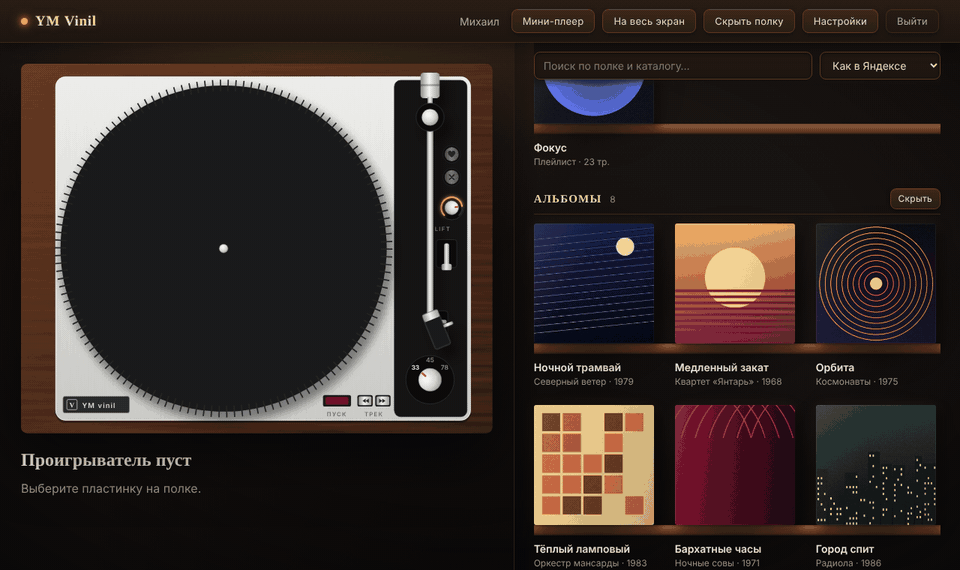
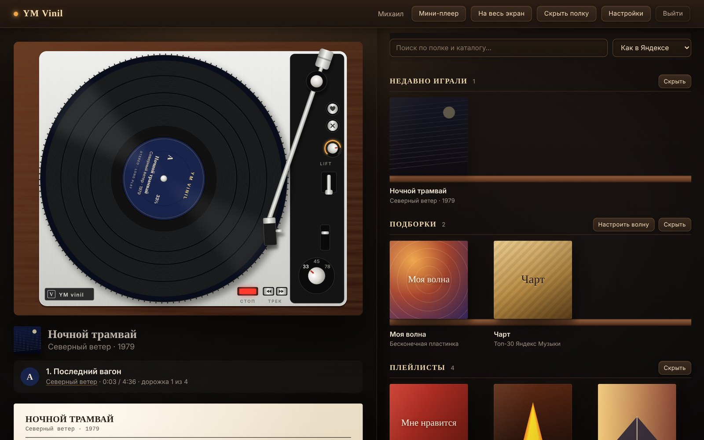
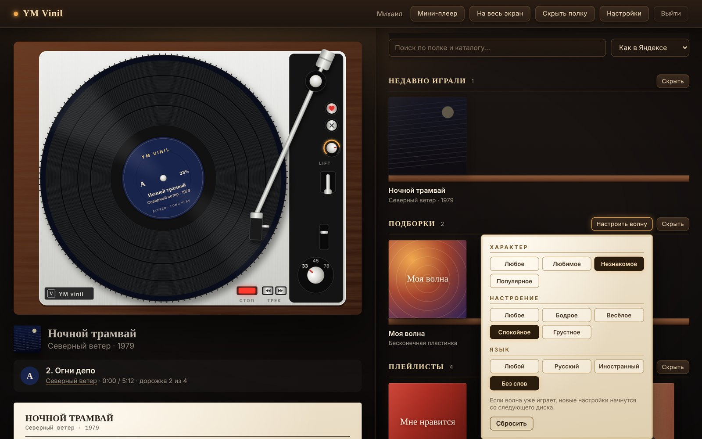
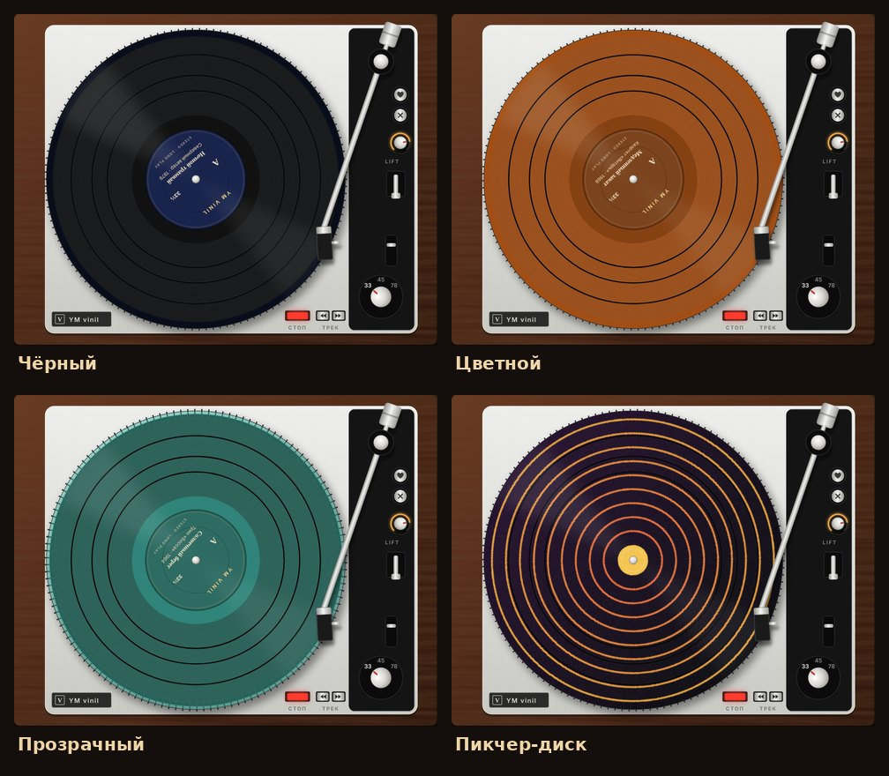
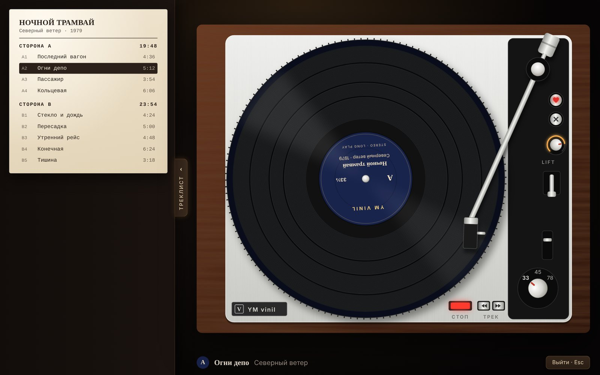
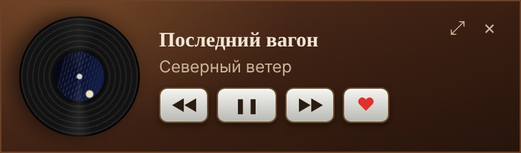

<div align="center">

# YM Vinil

**Ваша Яндекс Музыка — как пластинки на проигрывателе.**

Плейлисты и альбомы стоят на полке в конвертах. Достаёте пластинку, кладёте на диск,
жмёте «Пуск» — тонарм опускает иглу, и альбом играет стороной A. Сторона закончилась — переверните.

[](https://github.com/474K474/YM_vinil/releases/latest)
[](https://github.com/474K474/YM_vinil/stargazers)




</div>

> Неофициальный проект, не связан с Яндексом. Нужна подписка Яндекс Плюс — оболочка её не обходит.

## Что умеет



**Ритуал, а не плейлист.**
- Любой альбом, плейлист, «Мне нравится», чарт или «Моя волна» превращается в пластинку:
  треки делятся на **стороны A/B** примерно по 23 минуты, длинные подборки — на несколько дисков.
- **Проигрыватель вид сверху**: ореховый корпус, серебристая дека, прямой тонарм.
  Красная клавиша — мотор с разгоном и выбегом, **LIFT** — поднять иглу, клик по бороздке — нужный трек,
  ручка **33 / 45 / 78** ускоряет и звук, как на настоящем виниле.
- Игла ползёт к центру по ходу стороны, в паузах между треками видны гладкие кольца.
  В конце — выводная канавка и кнопка «Перевернуть».

**Звук винила** — тёплый тон, ламповое насыщение, лёгкое плавание скорости и треск.
Сила эффекта настраивается, выключается одним тумблером.

**Моя волна** — бесконечная пластинка: новые диски прессуются по мере игры.
Настройки как в Яндексе — характер, настроение, язык.



**Виды винила** — чёрный, цветной под обложку, прозрачный и пикчер-диск.



**Полный экран** — только проигрыватель и выдвижной треклист с обратной стороны конверта.



**И ещё:**
- ♥ и ✕ прямо на деке — лайки синхронизируются с Яндекс Музыкой (видно и на телефоне);
- поиск по своей полке и каталогу, сортировка, «Недавно играли», чарт и новинки;
- витрина исполнителя: «Лучшее» и все альбомы по годам;
- **мини-плеер** поверх всех окон и сворачивание в трей;
- статус в **Discord** «Слушает YM Vinil» — скоро;
- медиаклавиши и системный оверлей Windows;
- **автообновление**: новая версия ставится в один клик.

<div align="center"></div>

## Установка

1. Скачайте установщик в [Releases](https://github.com/474K474/YM_vinil/releases/latest):
   Windows — `…_x64-setup.exe`, macOS — `.dmg`, Linux — `.AppImage` или `.deb`.
2. Сборки пока без платной подписи кода:
   - **Windows:** SmartScreen → «Подробнее» → «Выполнить в любом случае»;
   - **macOS:** правый клик по приложению → «Открыть».
3. Войдите через Яндекс — и ставьте первую пластинку.

Дальше приложение обновляется само.

## Приватность

- Вход — на официальной странице `oauth.yandex.ru` в окне приложения. Пароль приложение не видит.
- Токен хранится только на вашем компьютере, в системном хранилище паролей
  (Windows Credential Manager, macOS Keychain, Secret Service на Linux) и никогда не попадает в интерфейс.
- Все запросы идут напрямую с вашего компьютера на серверы Яндекса.
  **У проекта нет своего сервера, аналитики и телеметрии.**
- Статус в Discord (когда появится) будет уходить только в локальный клиент Discord и выключаться в настройках.
- «Выйти» удаляет токен.

## Вопросы

**Это бесплатно?** Да, и код открыт (MIT). Но для музыки нужна ваша подписка Яндекс Плюс.

**Почему Windows ругается при установке?** Сборка не подписана платным сертификатом.
Установщики собирает GitHub Actions прямо из этого репозитория — это видно во вкладке Actions.

**Чем это отличается от тем для приложения Яндекс Музыки?** Это отдельное приложение:
не патчит официальный клиент и не ломается после его обновлений.

**Я нашёл баг / есть идея.** Откройте [issue](https://github.com/474K474/YM_vinil/issues) — будем рады.

## Разработка

Нужны [Node.js](https://nodejs.org) (LTS), [Rust](https://rustup.rs)
и [системные зависимости Tauri](https://v2.tauri.app/start/prerequisites/).

```bash
npm install
npm run tauri dev     # запуск с горячей перезагрузкой
npm test              # тесты логики (нарезка на стороны, геометрия, цвет, волна)
npm run tauri build   # установщик для текущей системы
```

Стек: Tauri 2 (Rust) + React 19 + TypeScript + Vite + Zustand + Motion.
Как всё устроено и куда проект движется — в [docs/PROJECT.md](docs/PROJECT.md).

| Где | Что |
|---|---|
| `src-tauri/src/auth.rs` | окно входа, перехват токена, системное хранилище |
| `src-tauri/src/ym.rs` | запросы к API Яндекс Музыки, загрузка треков и обложек |
| `src-tauri/src/tray.rs`, `discord.rs` | трей, мини-плеер, статус в Discord |
| `src/player/` | нарезка на стороны, геометрия тонарма, движок, звук винила, волна |
| `src/components/` | проигрыватель, полка, конверт, настройки, полный экран |

Скриншоты и гифка снимаются на выдуманных альбомах: `docs/demo/`.

## Если понравилось

Поставьте ⭐ — так проект увидит больше людей.

## Лицензия

[MIT](LICENSE). Яндекс Музыка — товарный знак ООО «Яндекс»; проект с ним не связан.
